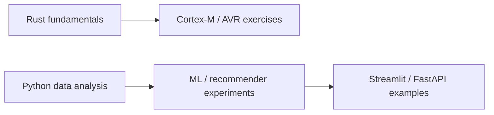

# 60-Day Rust and AI/ML Learning Challenge

This repository records Rust, embedded-programming and Python machine-learning exercises from the 2025 Leapfrog challenge. It is a collection of daily projects, rather than one application or a single Cargo workspace.

The first phase moves from Rust language exercises to Cortex-M/QEMU and AVR experiments. The second covers data preparation, recommenders, neural networks and small web/API examples.



## Start with a small Rust project

Install a Rust toolchain supporting the 2024 edition. From a clone of this repository:

```bash
git clone https://github.com/SuhanVerse/LSPP60days-Challenge_2025.git
cd LSPP60days-Challenge_2025
cargo test --manifest-path DAY_12/xrust_calclib/Cargo.toml --locked
```

The [calculator library](DAY_12/xrust_calclib) has no external Rust dependencies and includes unit tests. The separate published [`xrust_calclib` crate](https://crates.io/crates/xrust_calclib) can be added to another Rust project with `cargo add xrust_calclib`.

## Milestone index

| Stage | Start here | What is committed |
| --- | --- | --- |
| Rust basics | [Day 2](DAY_2), [Day 7](DAY_7), [Day 10](DAY_10) | Language, file/module and trait exercises |
| Library and macros | [Day 12](DAY_12), [Day 14](DAY_14) | Calculator library/app and procedural-macro workspace |
| Web and concurrency | [Day 18](DAY_18), [Day 20](DAY_20) | Wasm/browser experiment and Rust web server |
| Cortex-M | [Day 21](DAY_21/README.md), [Day 23](day_23), [Day 24](day_24) | QEMU/debug configuration and embedded projects |
| AVR / Uno | [Day 25](day-25), [Day 26](day-26), [Day 28](day-28), [Day 30](day-30) | Separate AVR sketches and per-project toolchains |
| Data and basic ML | [Day 31](day-31), [Day 34 EDA](day-34/eda.py), [Day 38](day-38) | Python analysis and model exercises |
| Text and recommendation | [Day 41](day-41), [Day 43](day-43), [Day 44](day-44) | TF-IDF, recommendation and evaluation examples |
| Neural networks | [Day 45](day-45), [Day 47](day-47), [Day 48](day-48) | Neural-network and classification scripts/models |
| UI and deployment exercises | [Day 50](day-50), [Day 51](day-51) | Streamlit and container examples |
| Collaborative / hybrid ranking | [Day 52](day-52), [Day 55](day-55), [Day 58](day-58) | Matrix-factorization, hybrid and BPR experiments |
| Recommender API | [Day 59](day-59), [Day 60 notes](day-60/README.md) | FastAPI source, data, saved models and Dockerfile |

Folder names use mixed `DAY_`, `day_` and `day-` forms; follow the links rather than assuming a naming scheme. There are 58 top-level day entries. Day 1 and Day 27 are absent, and `DAY_22` is a Git link without a committed `.gitmodules` mapping, so it is not a self-contained checked-out exercise.

## Embedded and Python setup notes

Each embedded directory has its own target/toolchain configuration. [Day 21](DAY_21/.cargo/config.toml) targets `thumbv7m-none-eabi` with QEMU; AVR projects such as [Day 25](day-25/rust-toolchain.toml) pin a nightly toolchain and use `ravedude`. Review that project's `Ravedude.toml` port and wiring before running commands that flash a connected board. There is no root `Cargo.toml`.

For Python work, create a virtual environment and inspect the imports and relative data/model paths in the exercise you choose. There is currently no checked-in root or Day 60 `requirements.txt`; a repository-wide `pip install -r requirements.txt` is therefore not a working setup command. Dependencies and serialized model versions still need to be reconstructed and tested before these exercises can claim fresh-clone reproducibility.

Day 60's Dockerfile references the missing dependency file, so its build is currently blocked. See the [specific setup gaps and API routes](day-60/README.md). Historical Docker Hub image links do not establish that the current source builds or is production ready.

Tracked `node_modules` and Python bytecode have been removed from the current tree. Use the retained manifests and lockfiles when reinstalling dependencies; model, dataset and research artifacts remain in their original folders. Historical commits still contain the old generated files.

## License and credits

The repository uses [Apache License 2.0](LICENSE). Embedded templates retain their original notices, including the Cortex-M quickstart attribution in the daily READMEs. This index describes the committed exercises and does not certify hardware runs or every day's completion.
